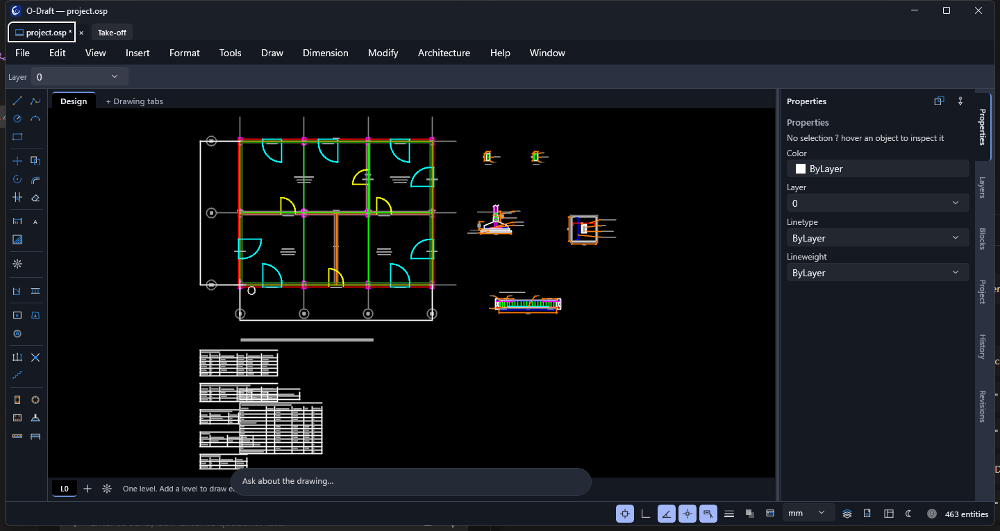
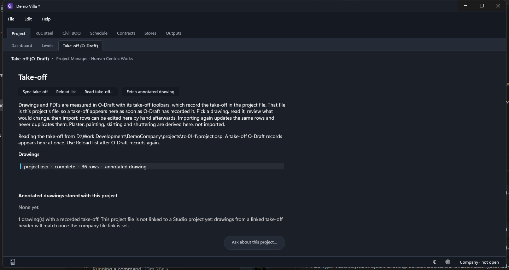

# Demo Villa: a demo company, a demo drawing and its take-off

A complete set of demo data for trying the suite end to end, made by the project's own tools.

| Piece | Made by | Where |
|---|---|---|
| Demo company **TestCo Demo Practice** (a client, project `TC-01 Demo Villa`, four role users) | `native/Adms.TestSeed` (test credentials in `docs/testing/.local/credentials.txt`, never committed) | `<run folder>\TestCo-<date>.osas` |
| The drawing: ground floor plan of 12 m x 9 m, grid, 12 columns, 4 doors, 8 windows, 4 rooms, five structural details | `build_demo_villa.py` (below) with `aad-cli` | the project file `projects\tc-01-1\project.osp` |
| The take-off: 7 walls, 12 openings, 12 columns, 4 rooms, 1 slab, with the annotated drawing PDF | the same script, then `takeoff.record` | the same project file |

## Make it

```powershell
# 1. the company (writes the company file, the project and the credentials file)
O-STUDIO\native\Adms.TestSeed\bin\Release\net8.0-windows\Adms.TestSeed.exe "D:\Work Development\DemoCompany"

# 2. the drawing and its structural details, into the project's .osp (the seed leaves a placeholder that is not a project file: move it aside first)
python build_demo_villa.py

# 3. the take-off: run the take-off tables, then record them in the project file
aad-cli run project.osp --cmd 'openings.sync {}' --cmd 'takeoff.brick {}' --cmd 'takeoff.beams {}' --cmd 'takeoff.columns {}' \
    --cmd 'takeoff.slab {}' --cmd 'takeoff.floor {}' --cmd 'takeoff.record {}' --save project.osp
```

Needs `aad-cli` 1.3.2 or later (`--save` to a `.osp` and the structural details in a save came with it).

## See it




